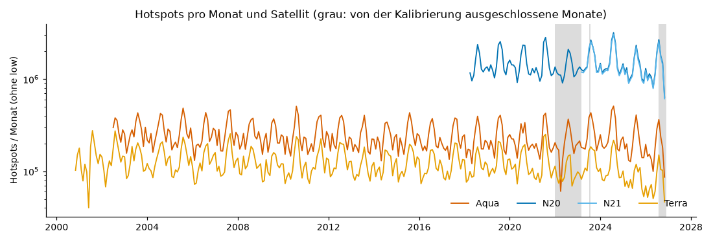
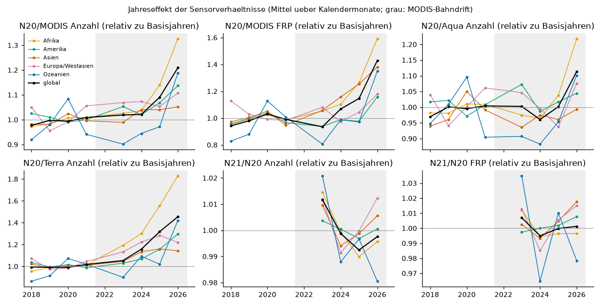
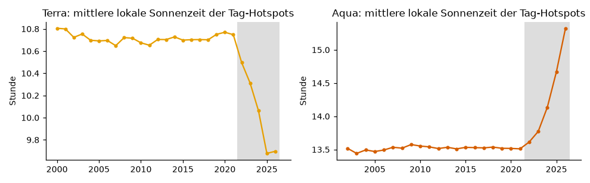
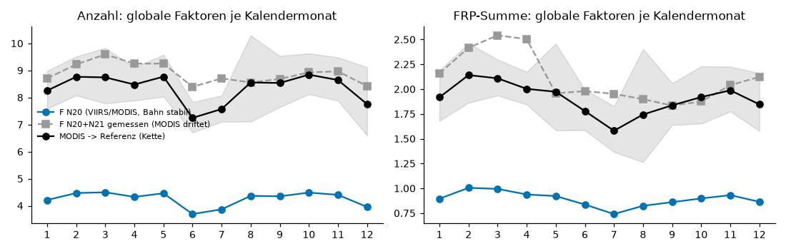

# Kalibrierung MODIS ↔ VIIRS: Bericht

Stand: 14.11.2026 · Backend (Data Server) · Antwort auf `HANDOFF_Backend_Kalibrierung.md`
Code: `kalibrierung/extract.py` (Stufe 1), `kalibrierung/calibrate.py` (Stufe 2), `kalibrierung/report.py` (Bericht)

---

## 0. Kurzfassung (Rückmeldung nach Abschnitt 11)

| Punkt | Ergebnis |
|---|---|
| **Referenz-Epoche** | `N20+N21` (40 saubere Monate, 2023-03 bis 2026-07) |
| **Epochen** | `N20`: 57 saubere Monate, davon 45 mit stabiler MODIS-Bahn (2018-04 bis 2021-12) → **Anker-Epoche** · `N20+N21`: 40 Monate |
| **SNPP** | **Nicht in den Daten.** VIIRS beginnt im Archiv erst am 2018-04-01 (N20). Es gibt deshalb keine Epoche `SNPP` |
| **Zeilen je Ebene** | cell 734.631 · block 20.275 · region 120 · global 24 (jeweils 2 Epochen × 12 Monate) |
| **Laufzeit** | Stufe 1 (alle 362,7 Mio. Punkte, einmal gelesen): 200 s · Stufe 2: 10 s (Spitze 2,2 GB RAM) · Server: 4 Kerne, 7 GB RAM |
| **Backtest** | Verzerrung ≤ 0,03 (log) überall. Mediane Abweichung Anzahl 0,13–0,23, FRP 0,16–0,29 (5°-Block × Monat × ein Jahr). Direkter VIIRS-Schritt N20→N20+N21: 0,04 / 0,08 |
| **Wichtigster Befund** | **Terra und Aqua driften seit 2022** (Tag-Überflug 2026: Terra −1,0 h, Aqua +1,8 h). MODIS ist in der Referenz-Epoche kein stabiler Maßstab. Der Referenzcode hätte `modis_to_ref` global um +5 % (Anzahl) bzw. +12 % (FRP) zu hoch angesetzt, in Afrika/Asien um bis zu +20 % (FRP). Deshalb wird über eine **Kette** kalibriert (Abschnitt 3) |
| **End-to-End** | Faktoren wie im Frontend angewandt: harmonisierte MODIS-Historie trifft VIIRS in 2018–2021 auf ±1,6 %, kein Sprung beim N21-Start (Abschnitt 7.7). Dafür war eine massenerhaltende Anpassung nötig (A11) |
| **Abnahme** | Alle Prüfungen aus Abschnitt 7 durchgeführt. Keine NaN/Inf in irgendeiner Faktorspalte. `viirs_to_ref` = 1,0 in der Referenz-Epoche. Mehr Satelliten → Faktor ×1,96 (Anzahl) bzw. ×2,13 (FRP). FRP-Backtest liegt über dem Richtwert 0,2 (Abschnitt 6) |

Globale Faktoren (Median über die Kalendermonate):

| | Anzahl | FRP-Summe |
|---|---|---|
| VIIRS/MODIS in Epoche `N20` (Bahn stabil) | 4,36 | 0,90 |
| `N20` → Referenz (direkt, VIIRS/VIIRS) | 1,96 | 2,13 |
| **MODIS → Referenz** (`factor_*_modis_to_ref`) | **8,55** | **1,92** |
| VIIRS/MODIS gemessen in `N20+N21` (MODIS driftet) | 8,82 | 2,01 |

---

## 1. Datenprüfung (Handoff Abschnitt 3)

**Quelle:** FIRMS-Archivdownloads, eine Parquet-Datei pro Jahr (`firms_data/parquet/firms_2000…2026.parquet`), 362.723.782 Zeilen.
Abbildung auf Tabelle A in `extract.py`: `sensor = instrument`, `satellite` (Terra, Aqua, N20, N21), `datetime_utc = acq_date + acq_time`,
`conf_class` nach der Handoff-Regel (MODIS 0–29 low, 30–79 nominal, 80–100 high; VIIRS l/n/h).

1. **Standard vs. NRT.** Bis Juli 2026 alles Standardprodukt (SP). NRT nur am Ende: VIIRS ab **2026-08-01**, MODIS ab **2026-09-01**. Die Monate **2026-08 bis 2026-11 werden nicht kalibriert** (`status = excluded_nrt`). 2026-11 ist zudem unvollständig (bis 14.11.). NRT und SP werden in keinem Pool gemischt.
2. **Produktversionen.** VIIRS: `2` (375 m, Collection 2) durchgehend, NRT `2.0NRT`. MODIS: Versionsstring **`6.03` bis 2022, `61.03` ab 2023**, NRT `6.1NRT`. Angefordert war in allen Fällen „MODIS C6.1“ (`DL_FIRE_M-C61_*`). Der Wechsel des Strings fällt zeitlich mit dem N21-Start und mit der Bahndrift zusammen. Seine Wirkung lässt sich deshalb nicht allein messen. Die Kette (Abschnitt 3) benutzt MODIS nur aus 2018–2021 (`6.03`), also dieselbe Version wie die gesamte MODIS-Historie 2000–2017, auf die der Faktor angewandt wird. **Offen:** bei FIRMS klären, ob `6.03` und `61.03` dieselbe Collection sind.
3. **Lücken und Ausreißer.** Kein Satellit hat einen fehlenden Monat. Teilmonate (Daten an < 90 % der Tage) im Überlappungszeitraum: **Aqua 2022-04 (47 %), Terra 2022-10 (61 %), N20 2023-07 (87 %)**. Sie werden ausgeschlossen (`excluded_partial`). Ausreißertest (robuster z-Wert der Monatssumme gegenüber demselben Kalendermonat) im Anhang. Alle Treffer mit vollständiger Tagesabdeckung sind echte Feueraktivität (z. B. 2020-02 Australien). Das wird jeweils dadurch bestätigt, dass N20 und N21 bzw. Terra und Aqua gemeinsam ausschlagen (N21/N20 in 2025-12: 0,95, normal).
4. **Dubletten.** 118 Zeilen mit gleichem `satellite, datetime_utc, latitude, longitude` entfernt (von 362,7 Mio.).
5. **Weitere Befunde.** `conf_class = low`: 9,4 % aller Punkte (VIIRS 11,5 %, MODIS 4–6 %), wie vorgegeben weggelassen. FIRMS-`type` 2 (statische Quellen, z. B. Gasfackeln) macht 6,5 % der VIIRS-, 6,2 % der Terra- und 2,7 % der Aqua-Punkte aus. Diese Punkte werden wie vorgegeben **mitgezählt**, weil das Frontend sie ebenfalls zählt (siehe offene Punkte).

## 2. Terra-Drift (Handoff Abschnitt 7.3a): bestätigt, und Aqua driftet auch

Mittlere lokale Sonnenzeit der Tag-Hotspots (aus `acq_time` + Länge/15), Abweichung von 2003–2019:

| Jahr | 2021 | 2022 | 2023 | 2024 | 2025 | 2026 |
|---|---|---|---|---|---|---|
| Terra (Basis ≈ 10:42) | +0,04 h | −0,21 h | −0,39 h | −0,64 h | −1,03 h | −1,01 h |
| Aqua (Basis ≈ 13:31) | −0,01 h | +0,09 h | +0,25 h | +0,61 h | +1,15 h | +1,80 h |

Bis 2021 sind beide Bahnen auf ±0,1 h stabil, danach driften beide deutlich. N20 und N21 bleiben konstant (13:22 ± 0,05 h). Die Folge zeigt der Jahreseffekt (relativ zu 2019–2021): **N20/Terra steigt bis 2026 auf 1,46** (Afrika 1,83). N20/MODIS steigt bei der Anzahl auf 1,21 und bei FRP auf 1,43. N20/Aqua bleibt bis 2025 stabil (±5 %) und steigt erst 2026. N21/N20 dagegen ist über alle Jahre auf ±1 % konstant.

Der Backtest zeigt dasselbe innerhalb der Referenz-Epoche: Die Verzerrung beim Weglassen eines Jahres wandert bei FRP von +0,08 (2023) nach −0,15 (2026), bei der Anzahl von +0,04 nach −0,05. Ein **Trend im Verhältnis innerhalb einer Epoche** liegt also vor, genau der Fall aus Abschnitt 7.3. Der direkte VIIRS-Schritt (N20→N20+N21) hat keinen Trend (|Verzerrung| ≤ 0,004 in jedem Jahr).

In der **Anker-Epoche** (2018-04 bis 2021-12) gibt es keinen relevanten Trend: global +0,9 %/Jahr (Anzahl) und +2,1 %/Jahr (FRP). Die Ausreißer sind Ozeanien FRP +8,7 %/Jahr (die Waldbrände 2019/20 mit extremem FRP fallen in nur 4 Jahre) und Europa/Westasien FRP −4,4 %/Jahr.

## 3. Methode und Abweichungen vom Referenzcode

Grundlage ist der Referenzcode aus Abschnitt 8: Monatsaggregation auf 0,5°, Pool je Zelle × Kalendermonat × Epoche über alle Jahre, Hierarchie global → Region → 5°-Block → Zelle mit Schrumpfung (`K_SHRINK = 200`, `MIN_SUPPORT = 30`), keine Einschränkung auf Zellen mit beiden Sensoren, Unsicherheit aus Jahresstreuung plus Zählrauschen, LOYO-Backtest. Die Parameter sind unverändert. Abweichungen:

| # | Änderung | Grund |
|---|---|---|
| A1 | Zwei Stufen: `extract.py` liest die 362,7 Mio. Punkte **einmal**, entfernt Dubletten und schreibt kleine Zwischentabellen (`cache/mc.parquet` = Monat × Zelle × Satellit × Tag/Nacht). `calibrate.py` rechnet nur darauf | Laufzeit (Handoff 6.3). Neuberechnung mit anderen Parametern dauert 10 s |
| A2 | Ein Monat geht nur in die Kalibrierung ein, wenn **kein NRT** enthalten ist und **jeder** Satellit an ≥ 90 % der Tage Daten hat (`MIN_DAY_COVERAGE`). Die Epoche eines Monats bleibt nach Handoff-Regel (≥ `MIN_SAT_MONTH` Hotspots). Teilmonate behalten also ihre Epoche für das Frontend, Spalte `partial` | Handoff 3.1 und 9.3 (Übergangsmonate) |
| A3 | **MODIS-Bahndrift** wird je Jahr erkannt (mittlere Tag-Überflugzeit weicht > 0,15 h von 2003–2019 ab) → `modis_orbit = drift` für 2022–2026 | Handoff 7.3a und 9.4 |
| A4 | **Kette statt MODIS-Maßstab:** `factor_*_modis_to_ref = F(N20, nur Monate mit stabiler Bahn) × D`, mit `D = Σ(N20+N21) / Σ(N20)` direkt gemessen in den Monaten der Referenz-Epoche (selbe Hierarchie und Schrumpfung). `factor_*_viirs_to_ref` der Epoche `N20` = `D`. Der Referenzcode benutzt `F_ref / F_N20`; das gilt im Code weiter für Epochen, deren Satelliten nicht Teil der Referenz sind (heute keine) | MODIS ist ab 2022 kein stabiler Maßstab mehr (Abschnitt 2). `D` braucht keinen MODIS-Wert, ist im Backtest 3–4× genauer und hat keinen Trend. Der Maßstab (MODIS 2018–2021) ist dieselbe Bahn und Version wie die MODIS-Historie, auf die das Frontend den Faktor anwendet |
| A5 | Neue Spalten `factor_*_modis_drift_to_ref` (= gemessenes VIIRS/MODIS der Referenz-Epoche) für MODIS-Monate mit `modis_orbit = drift` | Wer MODIS ab 2022 umrechnen will, braucht einen anderen Faktor. Es ist ein Mittel über 2023–2026, während die Drift jedes Jahr zunimmt (grob) |
| A6 | Neue Spalten `factor_*_modis_to_ref_lo/_hi` (80 %, Unsicherheit von F und D kombiniert) und `n_years_modis_anchor` | Das Frontend zeigt Bänder für MODIS × Faktor |
| A7 | Fehlt eine Zelle in einer Epoche, kommt `*_to_ref` aus der übergeordneten Ebene (w = 0) **schon in der Tabelle**. Jede gelieferte Zeile ist gefüllt | Die Rückfallregel Zelle → Block → Region → global bleibt gültig für Zellen, die gar nicht in der Tabelle stehen |
| A8 | Backtest zusätzlich für den direkten Schritt (`n_direct`, `frp_direct`), Spalte `abs_err_weighted` (gewichtet nach VIIRS-Summe), Region `alle` | Bewertung der Kette, Relevanz für die Feuermenge |
| A9 | Zusatzdateien: `calibration_daynight.csv`, `calibration_stability.csv`, `tabelle_c_firecal.csv`, `figures/` | Abschnitte 7.3, 9.2 und Übergabe an das bestehende Frontend |
| A11 | **Massenerhaltende Anpassung** (`RAKE`): Nach der Schrumpfung werden die Faktoren der Kinder je Eltern-Einheit mit `k = F_eltern · Σa / Σ(a · F_kind)` skaliert (top-down, `k` begrenzt auf 0,5–2). Typisch `k` ≈ 1,04 auf Zellen, ≈ 1,02 auf Blöcken, 1,000 auf Regionen. Begrenzt wurden nur 105 von 844.346 Zellzeilen | Ohne die Anpassung lag die harmonisierte Reihe aus MODIS in den Anker-Jahren **5 % unter** dem gemessenen VIIRS-Wert, wenn die Faktoren je Zelle angewandt werden. VIIRS-Hotspots in Zellen × Monaten ohne MODIS gingen verloren. Der Block-Backtest sieht diesen Fehler nicht. Mit der Anpassung: 0,99–1,00 (Abschnitt 7.7) |
| A10 | Kleinere Korrekturen: `n_years` der höheren Ebenen = Zahl der Jahre mit Daten (statt Maximum der Zellen), `log(0)`-Warnungen unterdrückt, globaler `shrink_weight = 1` | Korrektheit/Lesbarkeit |

**Was der Referenzcode geliefert hätte** (gleiche Daten, MODIS-Maßstab in der driftenden Referenz-Epoche). Das ist die Abweichung von `modis_to_ref`, Median über die Monate:

| Region | Anzahl | FRP |
|---|---|---|
| Afrika | +11 % | +20 % |
| Amerika | +5 % | +3 % |
| Asien | +5 % | +19 % |
| Europa/Westasien | +4 % | +5 % |
| Ozeanien | −4 % | +1 % |
| global | +5 % | +12 % |

## 4. Ergebnisse und Abnahmekriterien (Handoff Abschnitt 7)

### 7.1 Faktoren plausibel
`factor_n` liegt überall deutlich über `factor_frp`. In der Referenz-Epoche gilt global Anzahl 8,8 gegen FRP 2,0 (Muster: 6–11 gegen 2–4). Je Region (Median über die Monate):

| Region | N20 n | N20 FRP | N20+N21 n | N20+N21 FRP | **MODIS→Ref n** | **MODIS→Ref FRP** |
|---|---|---|---|---|---|---|
| Afrika | 4,18 | 1,04 | 8,84 | 2,56 | 8,19 | 2,20 |
| Amerika | 3,90 | 0,85 | 7,91 | 1,77 | 7,72 | 1,80 |
| Asien | 5,31 | 0,93 | 10,22 | 2,71 | 10,47 | 1,98 |
| Europa/Westasien | 4,93 | 0,89 | 9,82 | 2,12 | 9,62 | 1,95 |
| Ozeanien | 4,71 | 0,79 | 9,01 | 1,55 | 9,31 | 1,70 |

**Faktoren < 1:** Nur `factor_frp` der Epoche `N20` liegt in vielen Regionen/Monaten bei 0,55–1,0 (global 0,74–1,0). Das ist erklärbar und kein Fehler: Ein VIIRS-Satellit steht hier zwei MODIS-Satelliten gegenüber. Je Satellit liefert N20 etwa 1,8× die FRP-Summe eines MODIS-Satelliten. Am niedrigsten ist der Wert im Nordsommer (Juni–August: Amerika, Asien, Europa) und im Südsommer in Ozeanien. Dort machen große, heiße Brände einen großen FRP-Anteil aus. Vermutlich erfasst MODIS mit 1-km-Pixeln und zwei Überflugzeiten solche Brände mit vergleichsweise hoher FRP. Auf Zellebene mit eigenem Faktor: `factor_n < 1` in 26 (N20) bzw. 9 (N20+N21) von > 360.000 Zeilen, `factor_n > 30` in 73 Zeilen (nur N20+N21). Alles kleine Pools nahe `MIN_SUPPORT`. Perzentile p1–p99 auf Zellebene: Anzahl 2,3–10,1 (N20) bzw. 4,5–21,4 (N20+N21).

Region `Asien` hat die höchsten Anzahl-Faktoren (10,5), vermutlich wegen vieler kleiner Agrarfeuer, die MODIS mit 1-km-Pixeln nicht sieht.

### 7.2 Epochen konsistent
Mehr Satelliten ergeben einen größeren Faktor. `D` (N20 → N20+N21) = **1,94–1,97 (Anzahl)** und **2,12–2,15 (FRP)** in allen Monaten und Regionen. N21 sieht also 0,96× so viele Hotspots wie N20 mit 1,13× der FRP. `factor_*_viirs_to_ref` ist in der Referenz-Epoche in jeder Zeile genau 1,0 (geprüft).

### 7.3 Zeitliche Stabilität
Siehe Abschnitt 2. (a) Terra-Drift bestätigt, Aqua driftet ebenfalls → Kette (A4). (b) Versionswechsel MODIS 2023 ist nicht getrennt messbar und wird durch die Kette umgangen. (c) Übergangsmonate: N21 startet sauber am 2023-03-01 (voller Monat), N20 im Archiv am 2018-04-01. Teilmonate werden ausgeschlossen (A2). Die volle Zeitreihe je Region × Monat × Jahr steht in `calibration_stability.csv`.

### 7.4 Backtest (`calibration_backtest.csv`)
Leave-one-year-out auf 5°-Blöcken × Kalendermonat × Epoche, Log-Skala:

| Größe | Epoche | Verzerrung | mediane Abw. | gewichtet | p10 … p90 |
|---|---|---|---|---|---|
| Anzahl | N20 (Anker) | +0,013 | 0,162 | 0,129 | −0,34 … +0,40 |
| FRP | N20 (Anker) | −0,009 | **0,212** | 0,158 | −0,48 … +0,49 |
| Anzahl | N20+N21 | +0,017 | 0,184 | 0,169 | −0,37 … +0,45 |
| FRP | N20+N21 | +0,001 | **0,259** | 0,243 | −0,55 … +0,56 |
| Anzahl direkt | N20 → N20+N21 | +0,001 | 0,042 | 0,030 | −0,10 … +0,10 |
| FRP direkt | N20 → N20+N21 | +0,001 | 0,078 | 0,050 | −0,19 … +0,19 |

Die Verzerrung ist überall nahe 0 (≤ 0,034). **Über dem Richtwert 0,2** liegen:
- Anzahl: Europa/Westasien in N20 (0,20) und N20+N21 (0,23) sowie Asien in N20+N21 (0,22). Am schlechtesten ist Europa/Westasien im Januar (0,39 / 0,55, sehr wenige Winterfeuer).
- FRP: alle Regionen außer Afrika. Am höchsten sind Asien in N20+N21 (0,28, gewichtet 0,36), Europa/Westasien (0,29) und Ozeanien (0,28). In N20 liegen Ozeanien Jan/Feb (0,38/0,43) und Europa/Westasien im Januar (0,41) vorn.

Das Ergebnis ist kein Zeichen für einen falschen Faktor. Es zeigt die **natürliche Streuung des Verhältnisses in einem einzelnen Jahr auf 5° × Monat**: FRP wird von wenigen großen Bränden dominiert, die MODIS und VIIRS zu verschiedenen Uhrzeiten unterschiedlich treffen. Für ein einzelnes Jahr in einem 5°-Block muss man mit etwa ±25 % rechnen (Anzahl ±15–20 %). Größere Gebiete und längere Zeiträume sind genauer (gewichtete Abweichung 0,13 / 0,16). In der Epoche N20+N21 kommt die Drift dazu. Der für das Frontend relevante Pfad (MODIS-Historie → Referenz) nutzt nur den Anker (0,16 / 0,21) und den direkten Schritt (0,04 / 0,08).

### 7.5 Abdeckung
| | Zelle × Monat mit MODIS | davon eigener Faktor (w > 0) | Anteil der MODIS-Hotspots mit eigenem Faktor | … mit w > 0,5 |
|---|---|---|---|---|
| N20 (Anker) | 253.892 | 26,4 % | **91,4 %** | 67,6 % |
| N20+N21 | 245.970 | 24,8 % | 90,1 % | 63,2 % |
| MODIS-Historie 2000-11 bis 2018-03 | | | **80,5 %** | |

Drei Viertel der Zellen mit MODIS-Hotspots sind zu klein für einen eigenen Faktor und übernehmen den Blockwert. Sie enthalten aber nur ~9 % der Hotspots. 80 % der historischen MODIS-Hotspots liegen in Zellen und Monaten mit eigenem Faktor.

### 7.6 Keine NaN/Unendlich
Geprüft: 0 nicht-endliche Werte in **allen** Faktorspalten aller Ebenen (nicht nur `region`/`global`).

### 7.7 Zusätzlich: End-to-End-Prüfung wie im Frontend (`validate.py`, `validation_series.csv`)
Alle Zellen × Monate 2000–2026 werden mit den gelieferten Faktoren umgerechnet (Rückfall Zelle → Block → global). Danach wird die harmonisierte globale Reihe aus MODIS mit der aus VIIRS verglichen (Median über die Monate eines Jahres):

| Jahr | 2018 | 2019 | 2020 | 2021 | 2023 | 2024 | 2025 | 2026 |
|---|---|---|---|---|---|---|---|---|
| VIIRS_h / MODIS_h Anzahl | 0,996 | 0,993 | 0,996 | 1,001 | 0,974 | 0,964 | 1,020 | 1,096 |
| VIIRS_h / MODIS_h FRP | 0,984 | 0,996 | 1,005 | 1,006 | 0,952 | 0,937 | 1,062 | 1,234 |

- **Anker-Jahre 2018–2021: Abweichung ≤ 1,6 %.** Die MODIS-Historie wird also auf das richtige Niveau gehoben.
- **Übergang N20 → N20+N21** (2023-02 → 2023-03): kein Sprung. Harmonisiertes VIIRS 2,66 → 2,46 Mio., harmonisiertes MODIS im selben Schritt 2,88 → 2,52 Mio. (saisonaler Rückgang).
- **Drift-Jahre:** `modis_drift_to_ref` ist ein Mittelwert über 2023–2026. Das Verhältnis wandert deshalb von 0,96 (2024) auf 1,10 bzw. 1,23 (2026). Für diese Jahre gibt es VIIRS.

## 5. Entscheidungen aus Abschnitt 10, Empfehlung nach Datenlage

1. **Referenz-Epoche = aktuelle Konstellation:** umgesetzt (`N20+N21`). Wegen der fehlenden SNPP-Daten ist das nicht die vollständige heutige VIIRS-Konstellation (SNPP fliegt noch). Kommen SNPP-Daten dazu, wird die Referenz automatisch `N20+N21+SNPP` (Code ist generisch).
2. **Zellgröße 0,5° / Block 5°:** tragfähig. Bei 0,5° tragen eigene Faktoren 91 % der Hotspots. Feiner lohnt sich nicht: Schon bei 0,5° erreichen 74 % der Zellen × Monate im Pool der Anker-Epoche (45 Monate) nicht 30 Hotspots bei beiden Sensoren.
3. **Regionen:** weiterhin die Platzhalter-Boxen (identisch mit `firecal/backend/regions.py`). Eine Länder-/Biom-Geometrie liegt auf dem Server nicht vor. `region_of()` ist die einzige Stelle, die getauscht werden muss.
4. **Tag/Nacht getrennt: nein (empfohlen).** Die Faktoren unterscheiden sich stark (N20 global: Anzahl Tag 3,4 / Nacht 9,4; FRP 0,88 / 0,71). Getrennte Faktoren **verschlechtern** aber den Backtest der Gesamtwerte (Anzahl 0,173 → 0,194, FRP 0,233 → 0,239), weil die Nacht-Pools klein sind und der Tag-/Nacht-Mix je Zelle × Monat schon im gepoolten Faktor steckt. `calibration_daynight.csv` liefert die Faktoren je Region × Monat × Epoche × Tag/Nacht für Ansichten, die nur Tag oder nur Nacht zeigen.

## 6. Offene Punkte und Auffälligkeiten

1. **SNPP fehlt.** Mit SNPP-Daten (FIRMS `V-C2`, 2012-01-20 bis heute) würde VIIRS 6 Jahre früher beginnen, und es gäbe die Epochen `SNPP`, `N20+SNPP`, `N20+N21+SNPP`. **Empfehlung: SNPP nachladen und Stufe 1+2 erneut laufen lassen** (ca. 5 Minuten). Bis dahin gilt im Frontend: VIIRS-Beginn **2018-04-01**, nicht 2012-01-20 (`VIIRS_START`/`SATELLITES` in `firecal/backend/regions.py` gehen von SNPP aus).
2. **Das Frontend summiert „nativ VIIRS“ ohne Epochenkorrektur.** Der heutige Platzhalter (`harmonization.py`) kennt nur einen MODIS-Faktor je Region (× Monat). Mit `tabelle_c_firecal.csv` (MODIS → Referenzniveau, Format der heutigen Tabelle C, Bänder = 80 %-Intervall statt p25/p75) wird die MODIS-Historie richtig skaliert. Die N20-Jahre 2018-04 bis 2023-02 müssen aber zusätzlich mit `factor_*_viirs_to_ref` (≈ 1,96 / 2,13) multipliziert werden, sonst bleibt der Sprung im März 2023. Dafür muss `weights_sql()` die Epoche aus `sensor_timeline.json` kennen. **Die Datei ist noch nicht in `/opt/firecal/data/calibration/` eingespielt**, weil das den laufenden Dienst ändert und die VIIRS-Epochenkorrektur dort noch fehlt.
3. **MODIS 2022–2026** (Bahndrift): Ein Faktor je Zelle × Monat kann die jährlich wachsende Drift nicht abbilden. `factor_*_modis_drift_to_ref` ist ein Mittel über 2023–2026. Für diese Jahre sollte das Frontend VIIRS nativ zeigen (ist vorhanden). Terra und Aqua erreichen das Ende ihrer Mission. Eine getrennte Kalibrierung je MODIS-Satellit (Handoff 9.4) bringt nichts, weil beide driften.
4. **MODIS-Versionsstring `6.03` → `61.03` (2023):** bei FIRMS klären. Die Kette ist davon nicht betroffen, `modis_drift_to_ref` schon.
5. **FIRMS-`type` 2/3 (statische Quellen, offshore):** werden mitkalibriert, wie das Frontend sie zählt. Bei VIIRS ist der Anteil statischer Quellen 2,4× so hoch wie bei Aqua. Wenn das Frontend sie später ausfiltert, sollte die Kalibrierung mit demselben Filter neu laufen (eine Zeile in `extract.py`).
6. **Unsicherheitsband:** wie im Handoff (Jahresstreuung + Poisson). Auf Zellebene eher zu eng. Für FRP unterschätzt das Poisson-Glied (auf Basis der Anzahl) die Streuung.
7. **Ausgeschlossene Monate:** 2022-04, 2022-10, 2023-07 (Teilmonate), 2022-01 bis 2023-02 (N20 mit driftendem MODIS: weder Anker noch Referenz), 2026-08 bis 2026-11 (NRT).

## 7. Dateien und Anwendung

`calibration_out/`:

| Datei | Inhalt |
|---|---|
| `calibration.parquet` | Lange Tabelle aller Ebenen, Schema laut Handoff + Spalten aus A5/A6 |
| `sensor_timeline.json` | `reference_era`, `anchor_era`, `apply` (Regeln), `modis_drift_years`, Überflugzeiten, `eras`, `months` (je Monat: `modis_set`, `viirs_set`, `era`, `partial`, `nrt`, `modis_orbit`, `min_day_coverage`, `versions`, `status`, `calibration_pool`) |
| `calibration_backtest.csv` | Backtest je Größe × Region × Epoche |
| `calibration_report.md` | dieser Bericht, `figures/` |
| `calibration_daynight.csv` | Faktoren je Region × Monat (0 = alle) × Epoche × Tag/Nacht |
| `calibration_stability.csv` | Summen und Verhältnisse je Region × Jahr × Monat (alle sauberen Überlappungsmonate) |
| `tabelle_c_firecal.csv` | MODIS → Referenz je Region × Monat im Format der heutigen Tabelle C von firecal |
| `validation_series.csv` | Harmonisierte globale Monatsreihe aus MODIS und aus VIIRS (End-to-End-Prüfung) |

**Anwendung im Frontend** (auch in `sensor_timeline.json → apply`):
- MODIS-Monat mit `modis_orbit = nominal` (2000-11 bis 2021-12): `Wert × factor_*_modis_to_ref`
- MODIS-Monat mit `modis_orbit = drift` (2022+): `Wert × factor_*_modis_drift_to_ref`
- VIIRS-Monat in Epoche `e`: `Wert × factor_*_viirs_to_ref` (Epoche `N20`: ≈ 1,96 / 2,13; Referenz: 1)
- Rückfall: Zelle → Block → Region → global. Schlüssel: `cell_id = c<floor((lat+90)/0,5)>_<floor((lon+180)/0,5)>`, Block `b<…/5>`

**Neu rechnen:** `cd kalibrierung && .venv/bin/python extract.py && .venv/bin/python calibrate.py && .venv/bin/python validate.py && .venv/bin/python report.py`. Nur Stufe 2 bis Bericht: ca. 1 Minute

---

## Anhang: alle Tabellen (automatisch erzeugt von `report.py`)

### Ausreisser (Punktzahl je Satellit, robuster z-Wert > 3,5 gegenueber demselben Kalendermonat)

| date    | satellite   |       n |      z | status               |   min_day_coverage |
|:--------|:------------|--------:|-------:|:---------------------|-------------------:|
| 2001-06 | Terra       |   40203 |  -6.03 | modis_only           |               0.5  |
| 2003-05 | Terra       |  185693 |   3.53 | modis_only           |               1    |
| 2020-02 | N20         | 1428676 |   5.8  | calibration          |               1    |
| 2020-08 | Aqua        |  260051 |  -4.51 | calibration          |               1    |
| 2022-04 | Aqua        |   60736 | -10.27 | excluded_partial     |               0.47 |
| 2023-02 | N20         | 1356622 |   4.28 | excluded_modis_drift |               1    |
| 2023-10 | N21         | 1834108 |   3.77 | calibration          |               1    |
| 2024-06 | N20         | 1523252 |   3.79 | calibration          |               1    |
| 2025-07 | Terra       |  101986 |  -3.78 | calibration          |               1    |
| 2025-12 | N21         |  898477 | -13.05 | calibration          |               1    |
| 2025-12 | Terra       |   53159 |  -4.6  | calibration          |               1    |
| 2026-01 | N21         | 1243590 |  -4.48 | calibration          |               0.97 |
| 2026-01 | Terra       |   69720 |  -4.17 | calibration          |               0.97 |
| 2026-02 | N20         | 1001731 |  -4.65 | calibration          |               1    |
| 2026-02 | N21         |  959768 |  -7.54 | calibration          |               1    |
| 2026-07 | Terra       |  100167 |  -3.92 | calibration          |               1    |
| 2026-11 | Aqua        |   86550 |  -5.52 | excluded_nrt         |               0.47 |
| 2026-11 | N20         |  637024 |  -7.72 | excluded_nrt         |               0.47 |
| 2026-11 | Terra       |   46604 |  -4.87 | excluded_nrt         |               0.47 |

### Mittlere lokale Sonnenzeit der MODIS-Tag-Hotspots (Abweichung von der Basis 2003-2019)

|   Jahr |   Aqua |   Terra |
|-------:|-------:|--------:|
|   2000 |        |    0.1  |
|   2001 |        |    0.1  |
|   2002 |  -0.01 |    0.02 |
|   2003 |  -0.08 |    0.05 |
|   2004 |  -0.03 |   -0.01 |
|   2005 |  -0.06 |   -0.01 |
|   2006 |  -0.03 |   -0.01 |
|   2007 |   0.01 |   -0.05 |
|   2008 |  -0    |    0.02 |
|   2009 |   0.05 |    0.01 |
|   2010 |   0.03 |   -0.03 |
|   2011 |   0.01 |   -0.05 |
|   2012 |  -0.01 |    0    |
|   2013 |   0.01 |    0    |
|   2014 |  -0.01 |    0.03 |
|   2015 |   0.01 |   -0.01 |
|   2016 |   0    |    0    |
|   2017 |   0    |    0    |
|   2018 |   0.01 |   -0    |
|   2019 |  -0.01 |    0.05 |
|   2020 |  -0.01 |    0.07 |
|   2021 |  -0.01 |    0.04 |
|   2022 |   0.09 |   -0.21 |
|   2023 |   0.25 |   -0.39 |
|   2024 |   0.61 |   -0.64 |
|   2025 |   1.15 |   -1.03 |
|   2026 |   1.8  |   -1.01 |

### Jahreseffekt N20/MODIS und N21/N20 (exp. Mittel der Log-Abweichung je Kalendermonat; 1,00 = Basis)

**N20/MODIS Anzahl**

|   Jahr |   Afrika |   Amerika |   Asien |   Europa/Westasien |   Ozeanien |   global |
|-------:|---------:|----------:|--------:|-------------------:|-----------:|---------:|
|   2018 |    0.972 |     1.025 |   0.983 |              1.051 |      0.92  |    0.977 |
|   2019 |    0.984 |     1.01  |   0.98  |              0.955 |      0.98  |    0.997 |
|   2020 |    1.007 |     0.991 |   1.024 |              0.991 |      1.084 |    0.994 |
|   2021 |    1.009 |     1     |   0.996 |              1.056 |      0.941 |    1.009 |
|   2023 |    1.026 |     1.053 |   0.989 |              1.069 |      0.902 |    1.019 |
|   2024 |    1.037 |     1.02  |   1.041 |              1.073 |      0.945 |    1.021 |
|   2025 |    1.139 |     1.068 |   1.04  |              1.054 |      0.972 |    1.091 |
|   2026 |    1.327 |     1.137 |   1.052 |              1.107 |      1.189 |    1.21  |

**N20/MODIS FRP**

|   Jahr |   Afrika |   Amerika |   Asien |   Europa/Westasien |   Ozeanien |   global |
|-------:|---------:|----------:|--------:|-------------------:|-----------:|---------:|
|   2018 |    0.952 |     0.956 |   0.972 |              1.129 |      0.828 |    0.942 |
|   2019 |    0.99  |     0.997 |   1.005 |              1.028 |      0.88  |    0.98  |
|   2020 |    1.025 |     1.038 |   1.051 |              0.99  |      1.127 |    1.031 |
|   2021 |    0.985 |     0.966 |   0.947 |              0.983 |      1.008 |    0.991 |
|   2023 |    1.053 |     0.937 |   1.058 |              1.08  |      0.806 |    0.935 |
|   2024 |    1.103 |     0.989 |   1.158 |              0.973 |      0.988 |    1.068 |
|   2025 |    1.264 |     0.976 |   1.254 |              1.044 |      0.971 |    1.146 |
|   2026 |    1.592 |     1.158 |   1.381 |              1.179 |      1.35  |    1.429 |

**N20/Aqua Anzahl**

|   Jahr |   Afrika |   Amerika |   Asien |   Europa/Westasien |   Ozeanien |   global |
|-------:|---------:|----------:|--------:|-------------------:|-----------:|---------:|
|   2018 |    0.981 |     1.017 |   0.939 |              1.04  |      0.948 |    0.969 |
|   2019 |    0.981 |     1.021 |   0.961 |              0.941 |      1.009 |    1.001 |
|   2020 |    1.01  |     0.972 |   1.05  |              1.001 |      1.096 |    0.995 |
|   2021 |    1.009 |     1.008 |   0.991 |              1.061 |      0.904 |    1.004 |
|   2023 |    0.975 |     1.073 |   0.936 |              1.046 |      0.907 |    1.003 |
|   2024 |    0.965 |     0.987 |   0.975 |              0.996 |      0.882 |    0.961 |
|   2025 |    1.038 |     1.017 |   0.961 |              0.937 |      0.953 |    1.001 |
|   2026 |    1.218 |     1.044 |   0.993 |              1.076 |      1.102 |    1.114 |

**N20/Terra Anzahl**

|   Jahr |   Afrika |   Amerika |   Asien |   Europa/Westasien |   Ozeanien |   global |
|-------:|---------:|----------:|--------:|-------------------:|-----------:|---------:|
|   2018 |    0.954 |     1.036 |   1.022 |              1.072 |      0.864 |    0.994 |
|   2019 |    0.992 |     0.995 |   0.983 |              0.973 |      0.914 |    0.991 |
|   2020 |    0.996 |     1.016 |   1.006 |              0.983 |      1.072 |    0.991 |
|   2021 |    1.012 |     0.988 |   1.01  |              1.045 |      1.02  |    1.018 |
|   2023 |    1.192 |     1.029 |   1.045 |              1.132 |      0.9   |    1.053 |
|   2024 |    1.302 |     1.067 |   1.133 |              1.222 |      1.092 |    1.157 |
|   2025 |    1.554 |     1.157 |   1.16  |              1.284 |      1.02  |    1.318 |
|   2026 |    1.83  |     1.297 |   1.143 |              1.219 |      1.421 |    1.456 |

**N21/N20 Anzahl**

|   Jahr |   Afrika |   Amerika |   Asien |   Europa/Westasien |   Ozeanien |   global |
|-------:|---------:|----------:|--------:|-------------------:|-----------:|---------:|
|   2023 |    1.014 |     1.004 |   1.01  |              1.012 |      1.021 |    1.012 |
|   2024 |    0.999 |     1     |   0.994 |              0.991 |      0.988 |    0.999 |
|   2025 |    0.99  |     0.997 |   0.999 |              1     |      0.997 |    0.992 |
|   2026 |    0.996 |     1.001 |   1.006 |              1.012 |      0.981 |    0.998 |

**N21/N20 FRP**

|   Jahr |   Afrika |   Amerika |   Asien |   Europa/Westasien |   Ozeanien |   global |
|-------:|---------:|----------:|--------:|-------------------:|-----------:|---------:|
|   2023 |    1.012 |     0.997 |   1.003 |              1.013 |      1.035 |    1.007 |
|   2024 |    0.995 |     1     |   0.993 |              0.985 |      0.965 |    0.995 |
|   2025 |    0.996 |     1.002 |   1.005 |              1.005 |      1.01  |    1     |
|   2026 |    0.996 |     1.008 |   1.018 |              1.015 |      0.978 |    1.001 |

### Trend innerhalb der Anker-Epoche N20 (2018-04 bis 2021-12, MODIS-Bahn stabil), % pro Jahr

| Region           |   N20/MODIS Anzahl |   N20/MODIS FRP |
|:-----------------|-------------------:|----------------:|
| Afrika           |                1.4 |             1.4 |
| Amerika          |               -0.9 |             0.7 |
| Asien            |                0.8 |            -0.4 |
| Europa/Westasien |                0.5 |            -4.4 |
| Ozeanien         |                1.7 |             8.7 |
| global           |                0.9 |             2.1 |

### Faktoren je Region und Epoche (Median ueber die 12 Kalendermonate)

| Region           | era     |   factor_n |   factor_frp |   n_viirs_to_ref |   frp_viirs_to_ref |   n_modis_to_ref |   frp_modis_to_ref |   frp_modis_drift_to_ref |
|:-----------------|:--------|-----------:|-------------:|-----------------:|-------------------:|-----------------:|-------------------:|-------------------------:|
| Afrika           | N20     |      4.179 |        1.039 |            1.956 |              2.127 |            8.195 |              2.2   |                    2.56  |
| Afrika           | N20+N21 |      8.836 |        2.56  |            1     |              1     |            8.195 |              2.2   |                    2.56  |
| Amerika          | N20     |      3.899 |        0.848 |            1.973 |              2.133 |            7.717 |              1.8   |                    1.774 |
| Amerika          | N20+N21 |      7.905 |        1.774 |            1     |              1     |            7.717 |              1.8   |                    1.774 |
| Asien            | N20     |      5.306 |        0.933 |            1.969 |              2.145 |           10.471 |              1.975 |                    2.705 |
| Asien            | N20+N21 |     10.215 |        2.705 |            1     |              1     |           10.471 |              1.975 |                    2.705 |
| Europa/Westasien | N20     |      4.927 |        0.891 |            1.96  |              2.148 |            9.615 |              1.948 |                    2.114 |
| Europa/Westasien | N20+N21 |      9.82  |        2.114 |            1     |              1     |            9.615 |              1.948 |                    2.114 |
| Ozeanien         | N20     |      4.709 |        0.788 |            1.968 |              2.165 |            9.313 |              1.697 |                    1.547 |
| Ozeanien         | N20+N21 |      9.016 |        1.547 |            1     |              1     |            9.313 |              1.697 |                    1.547 |
| global           | N20     |      4.357 |        0.897 |            1.961 |              2.134 |            8.546 |              1.918 |                    2.01  |
| global           | N20+N21 |      8.817 |        2.01  |            1     |              1     |            8.546 |              1.918 |                    2.01  |

### Globale Faktoren je Kalendermonat

|   month |   factor_n N20 |   factor_n N20+N21 |   factor_frp N20 |   factor_frp N20+N21 |   factor_n_viirs_to_ref |   factor_frp_viirs_to_ref |   factor_n_modis_to_ref |   factor_n_modis_to_ref_lo |   factor_n_modis_to_ref_hi |   factor_frp_modis_to_ref |   factor_frp_modis_to_ref_lo |   factor_frp_modis_to_ref_hi |
|--------:|---------------:|-------------------:|-----------------:|---------------------:|------------------------:|--------------------------:|------------------------:|---------------------------:|---------------------------:|--------------------------:|-----------------------------:|-----------------------------:|
|       1 |          4.21  |              8.704 |            0.895 |                2.159 |                   1.961 |                     2.142 |                   8.256 |                      7.588 |                      8.982 |                     1.917 |                        1.68  |                        2.188 |
|       2 |          4.468 |              9.224 |            1.005 |                2.417 |                   1.962 |                     2.13  |                   8.764 |                      8.074 |                      9.514 |                     2.141 |                        1.863 |                        2.462 |
|       3 |          4.497 |              9.592 |            0.994 |                2.542 |                   1.944 |                     2.121 |                   8.744 |                      7.78  |                      9.827 |                     2.109 |                        1.936 |                        2.298 |
|       4 |          4.325 |              9.252 |            0.938 |                2.504 |                   1.96  |                     2.135 |                   8.479 |                      7.886 |                      9.117 |                     2.003 |                        1.845 |                        2.174 |
|       5 |          4.46  |              9.254 |            0.922 |                1.957 |                   1.967 |                     2.14  |                   8.77  |                      8.031 |                      9.577 |                     1.973 |                        1.584 |                        2.459 |
|       6 |          3.692 |              8.394 |            0.837 |                1.98  |                   1.962 |                     2.126 |                   7.246 |                      6.706 |                      7.829 |                     1.779 |                        1.586 |                        1.995 |
|       7 |          3.866 |              8.706 |            0.741 |                1.952 |                   1.959 |                     2.133 |                   7.573 |                      7.106 |                      8.071 |                     1.58  |                        1.366 |                        1.828 |
|       8 |          4.365 |              8.555 |            0.824 |                1.899 |                   1.96  |                     2.118 |                   8.556 |                      7.109 |                     10.297 |                     1.744 |                        1.265 |                        2.405 |
|       9 |          4.348 |              8.685 |            0.861 |                1.835 |                   1.963 |                     2.133 |                   8.537 |                      7.644 |                      9.534 |                     1.837 |                        1.638 |                        2.06  |
|      10 |          4.485 |              8.929 |            0.898 |                1.874 |                   1.972 |                     2.138 |                   8.844 |                      8.123 |                      9.628 |                     1.919 |                        1.652 |                        2.23  |
|      11 |          4.402 |              8.966 |            0.931 |                2.04  |                   1.964 |                     2.135 |                   8.645 |                      7.882 |                      9.483 |                     1.988 |                        1.775 |                        2.226 |
|      12 |          3.956 |              8.424 |            0.864 |                2.123 |                   1.961 |                     2.136 |                   7.756 |                      6.597 |                      9.118 |                     1.846 |                        1.577 |                        2.16  |

### Kette (diese Lieferung) gegen MODIS-Massstab (Referenzcode), Median ueber Monate

`*_viirs_to_ref` direkt (N21+N20)/N20 gegen F_ref/F_N20; letzte Spalten: um wie viel der Referenzcode `modis_to_ref` hoeher angesetzt haette.

| Region           |   factor_n_viirs_to_ref |   n_viirs_via_modis |   factor_frp_viirs_to_ref |   frp_viirs_via_modis |   dev_modis_to_ref_n_% |   dev_modis_to_ref_frp_% |
|:-----------------|------------------------:|--------------------:|--------------------------:|----------------------:|-----------------------:|-------------------------:|
| Afrika           |                   1.956 |               2.19  |                     2.127 |                 2.551 |                 11.416 |                   19.804 |
| Amerika          |                   1.973 |               2.082 |                     2.133 |                 2.198 |                  5.358 |                    2.764 |
| Asien            |                   1.969 |               2.052 |                     2.145 |                 2.569 |                  5.392 |                   18.851 |
| Europa/Westasien |                   1.96  |               2.017 |                     2.148 |                 2.273 |                  3.807 |                    4.951 |
| Ozeanien         |                   1.968 |               1.879 |                     2.165 |                 2.179 |                 -4.256 |                    0.544 |
| global           |                   1.961 |               2.071 |                     2.134 |                 2.385 |                  5.474 |                   11.964 |

### Abdeckung auf Zellebene (Zelle x Kalendermonat; Anteile in %)

| Epoche                                             |   Zellen_Monate_mit_MODIS |   Anteil_eigener_Faktor |   Anteil_MODIS_Hotspots_mit_eigenem_Faktor |   Anteil_MODIS_Hotspots_w_gt_05 |
|:---------------------------------------------------|--------------------------:|------------------------:|-------------------------------------------:|--------------------------------:|
| N20                                                |                    253892 |                    26.4 |                                       91.4 |                            67.6 |
| N20+N21                                            |                    245970 |                    24.8 |                                       90.1 |                            63.2 |
| MODIS-Historie 2000-11..2018-03 (nutzt N20-Zeilen) |                           |                         |                                       80.5 |                                 |

### Zellen mit eigenem Faktor und factor_n < 1 bzw. > 30

| era     |   lt1 |   gt30 |
|:--------|------:|-------:|
| N20     |    26 |      0 |
| N20+N21 |     9 |     73 |

### Verteilung factor_n / factor_frp auf Zellebene (nur eigener Faktor, w > 0)

| era     |   factor_n p1 |   factor_n p10 |   factor_n p50 |   factor_n p90 |   factor_n p99 |   factor_frp p1 |   factor_frp p10 |   factor_frp p50 |   factor_frp p90 |   factor_frp p99 |
|:--------|--------------:|---------------:|---------------:|---------------:|---------------:|----------------:|-----------------:|-----------------:|-----------------:|-----------------:|
| N20     |          2.33 |           3.05 |           4.15 |           6.23 |          10.13 |            0.42 |             0.63 |             0.98 |             1.62 |             2.45 |
| N20+N21 |          4.52 |           6.24 |           8.59 |          12.7  |          21.41 |            0.89 |             1.4  |             2.32 |             3.92 |             6.37 |

### Tag/Nacht: Faktoren ueber alle Monate (Pool der Epoche)

| region           | era     |   factor_frp D |   factor_frp N |   factor_frp alle |   factor_n D |   factor_n N |   factor_n alle |
|:-----------------|:--------|---------------:|---------------:|------------------:|-------------:|-------------:|----------------:|
| Afrika           | N20     |          1.005 |          0.986 |             1.004 |        3.564 |       10.122 |           4.023 |
| Afrika           | N20+N21 |          2.56  |          1.829 |             2.505 |        7.708 |       17.457 |           8.598 |
| Amerika          | N20     |          0.781 |          0.555 |             0.739 |        3.162 |        6.839 |           3.966 |
| Amerika          | N20+N21 |          1.738 |          1.059 |             1.58  |        6.566 |       13.199 |           8.432 |
| Asien            | N20     |          0.797 |          0.701 |             0.782 |        3.526 |       11.541 |           5     |
| Asien            | N20+N21 |          2.277 |          2.295 |             2.279 |        7.24  |       25.819 |          10.192 |
| Europa/Westasien | N20     |          0.762 |          1.045 |             0.814 |        2.566 |       14.442 |           4.409 |
| Europa/Westasien | N20+N21 |          1.618 |          1.827 |             1.669 |        5.19  |       24.787 |           9.378 |
| Ozeanien         | N20     |          0.709 |          0.739 |             0.713 |        3.435 |        9.255 |           4.679 |
| Ozeanien         | N20+N21 |          1.58  |          1.306 |             1.529 |        7.124 |       15.134 |           9.059 |
| global           | N20     |          0.884 |          0.707 |             0.863 |        3.442 |        9.354 |           4.225 |
| global           | N20+N21 |          2.15  |          1.405 |             2.037 |        7.299 |       16.825 |           8.844 |

**Tag-Anteil der MODIS-Hotspots**

| region           |   N20 |   N20+N21 |
|:-----------------|------:|----------:|
| Afrika           | 0.93  |     0.909 |
| Amerika          | 0.781 |     0.719 |
| Asien            | 0.816 |     0.841 |
| Europa/Westasien | 0.845 |     0.786 |
| Ozeanien         | 0.786 |     0.758 |
| global           | 0.868 |     0.838 |

### Backtest 5-Grad-Bloecke: ein Faktor gegen getrennte Tag/Nacht-Faktoren (alle Epochen)

| metric   | Methode            |     n |   bias_log |   abs_err_median |
|:---------|:-------------------|------:|-----------:|-----------------:|
| n        | gesamt             | 30479 |      0.016 |            0.173 |
| n        | Tag/Nacht getrennt | 30479 |      0.007 |            0.194 |
| frp      | gesamt             | 30476 |     -0.005 |            0.233 |
| frp      | Tag/Nacht getrennt | 30476 |      0.006 |            0.239 |

### Backtest (Leave-one-year-out, 5-Grad-Bloecke x Kalendermonat x Epoche, Log-Skala)

| metric     | region           | era     |     n |   bias_log |   abs_err_median |    p10 |   p90 |   abs_err_weighted |
|:-----------|:-----------------|:--------|------:|-----------:|-----------------:|-------:|------:|-------------------:|
| frp        | Afrika           | N20     |  3418 |     -0.004 |            0.155 | -0.402 | 0.411 |              0.104 |
| frp        | Amerika          | N20     |  5103 |     -0.016 |            0.217 | -0.486 | 0.466 |              0.189 |
| frp        | Asien            | N20     |  4884 |     -0.006 |            0.233 | -0.503 | 0.527 |              0.216 |
| frp        | Europa/Westasien | N20     |  1654 |     -0.006 |            0.249 | -0.48  | 0.562 |              0.261 |
| frp        | Ozeanien         | N20     |  1224 |     -0.013 |            0.235 | -0.574 | 0.553 |              0.29  |
| frp        | alle             | N20     | 16283 |     -0.009 |            0.212 | -0.48  | 0.486 |              0.158 |
| frp        | Afrika           | N20+N21 |  3083 |     -0     |            0.226 | -0.505 | 0.502 |              0.203 |
| frp        | Amerika          | N20+N21 |  4621 |     -0.006 |            0.252 | -0.539 | 0.509 |              0.256 |
| frp        | Asien            | N20+N21 |  4016 |      0.013 |            0.278 | -0.574 | 0.613 |              0.358 |
| frp        | Europa/Westasien | N20+N21 |  1334 |      0.006 |            0.287 | -0.587 | 0.602 |              0.272 |
| frp        | Ozeanien         | N20+N21 |  1057 |     -0.006 |            0.281 | -0.599 | 0.61  |              0.26  |
| frp        | alle             | N20+N21 | 14111 |      0.001 |            0.259 | -0.553 | 0.555 |              0.243 |
| frp_direct | Afrika           | N20+N21 |  4608 |      0.001 |            0.063 | -0.163 | 0.168 |              0.032 |
| frp_direct | Amerika          | N20+N21 |  6262 |      0     |            0.082 | -0.203 | 0.192 |              0.063 |
| frp_direct | Asien            | N20+N21 |  6699 |      0     |            0.074 | -0.179 | 0.18  |              0.067 |
| frp_direct | Europa/Westasien | N20+N21 |  2502 |      0.002 |            0.095 | -0.204 | 0.208 |              0.111 |
| frp_direct | Ozeanien         | N20+N21 |  1585 |      0.003 |            0.108 | -0.259 | 0.268 |              0.084 |
| frp_direct | alle             | N20+N21 | 21656 |      0.001 |            0.078 | -0.193 | 0.192 |              0.05  |
| n          | Afrika           | N20     |  3418 |      0.009 |            0.129 | -0.295 | 0.361 |              0.098 |
| n          | Amerika          | N20     |  5103 |      0.016 |            0.148 | -0.324 | 0.376 |              0.142 |
| n          | Asien            | N20     |  4885 |      0.021 |            0.195 | -0.376 | 0.451 |              0.179 |
| n          | Europa/Westasien | N20     |  1654 |      0.01  |            0.201 | -0.364 | 0.485 |              0.213 |
| n          | Ozeanien         | N20     |  1224 |     -0     |            0.152 | -0.325 | 0.345 |              0.143 |
| n          | alle             | N20     | 16284 |      0.013 |            0.162 | -0.341 | 0.403 |              0.129 |
| n          | Afrika           | N20+N21 |  3083 |      0.014 |            0.156 | -0.343 | 0.4   |              0.138 |
| n          | Amerika          | N20+N21 |  4621 |      0.019 |            0.17  | -0.347 | 0.402 |              0.175 |
| n          | Asien            | N20+N21 |  4016 |      0.018 |            0.221 | -0.434 | 0.514 |              0.257 |
| n          | Europa/Westasien | N20+N21 |  1334 |      0.034 |            0.228 | -0.401 | 0.518 |              0.236 |
| n          | Ozeanien         | N20+N21 |  1057 |      0.006 |            0.161 | -0.341 | 0.414 |              0.141 |
| n          | alle             | N20+N21 | 14111 |      0.017 |            0.184 | -0.371 | 0.446 |              0.169 |
| n_direct   | Afrika           | N20+N21 |  4608 |      0.001 |            0.037 | -0.091 | 0.095 |              0.024 |
| n_direct   | Amerika          | N20+N21 |  6262 |     -0.001 |            0.042 | -0.097 | 0.098 |              0.031 |
| n_direct   | Asien            | N20+N21 |  6699 |      0.001 |            0.044 | -0.098 | 0.101 |              0.042 |
| n_direct   | Europa/Westasien | N20+N21 |  2502 |      0.001 |            0.043 | -0.094 | 0.097 |              0.041 |
| n_direct   | Ozeanien         | N20+N21 |  1585 |      0.002 |            0.056 | -0.12  | 0.144 |              0.039 |
| n_direct   | alle             | N20+N21 | 21656 |      0.001 |            0.042 | -0.098 | 0.101 |              0.03  |

### Mediane Abweichung je Region und Kalendermonat (Backtest, |log|)

| metric   | era     | region           |    1 |    2 |    3 |    4 |    5 |    6 |    7 |    8 |    9 |   10 |   11 |   12 |
|:---------|:--------|:-----------------|-----:|-----:|-----:|-----:|-----:|-----:|-----:|-----:|-----:|-----:|-----:|-----:|
| frp      | N20     | Afrika           | 0.12 | 0.13 | 0.15 | 0.18 | 0.19 | 0.13 | 0.13 | 0.2  | 0.13 | 0.18 | 0.14 | 0.15 |
| frp      | N20     | Amerika          | 0.19 | 0.24 | 0.26 | 0.24 | 0.2  | 0.23 | 0.19 | 0.22 | 0.17 | 0.21 | 0.23 | 0.23 |
| frp      | N20     | Asien            | 0.23 | 0.21 | 0.18 | 0.22 | 0.26 | 0.24 | 0.22 | 0.29 | 0.24 | 0.25 | 0.21 | 0.22 |
| frp      | N20     | Europa/Westasien | 0.41 | 0.23 | 0.31 | 0.19 | 0.29 | 0.31 | 0.33 | 0.25 | 0.22 | 0.18 | 0.24 | 0.23 |
| frp      | N20     | Ozeanien         | 0.38 | 0.43 | 0.2  | 0.17 | 0.18 | 0.18 | 0.18 | 0.32 | 0.27 | 0.24 | 0.23 | 0.28 |
| frp      | N20+N21 | Afrika           | 0.22 | 0.21 | 0.21 | 0.26 | 0.28 | 0.21 | 0.31 | 0.15 | 0.18 | 0.22 | 0.23 | 0.24 |
| frp      | N20+N21 | Amerika          | 0.25 | 0.26 | 0.24 | 0.26 | 0.24 | 0.28 | 0.32 | 0.21 | 0.23 | 0.21 | 0.27 | 0.26 |
| frp      | N20+N21 | Asien            | 0.24 | 0.22 | 0.23 | 0.29 | 0.3  | 0.3  | 0.33 | 0.3  | 0.33 | 0.33 | 0.25 | 0.18 |
| frp      | N20+N21 | Europa/Westasien | 0.37 | 0.31 | 0.28 | 0.27 | 0.37 | 0.29 | 0.3  | 0.23 | 0.29 | 0.24 | 0.32 | 0.3  |
| frp      | N20+N21 | Ozeanien         | 0.32 | 0.32 | 0.37 | 0.24 | 0.25 | 0.26 | 0.25 | 0.23 | 0.3  | 0.28 | 0.29 | 0.39 |
| n        | N20     | Afrika           | 0.1  | 0.12 | 0.14 | 0.16 | 0.14 | 0.12 | 0.11 | 0.17 | 0.12 | 0.12 | 0.12 | 0.14 |
| n        | N20     | Amerika          | 0.16 | 0.14 | 0.15 | 0.14 | 0.15 | 0.15 | 0.13 | 0.16 | 0.12 | 0.15 | 0.16 | 0.18 |
| n        | N20     | Asien            | 0.18 | 0.15 | 0.15 | 0.17 | 0.22 | 0.2  | 0.2  | 0.23 | 0.21 | 0.19 | 0.17 | 0.17 |
| n        | N20     | Europa/Westasien | 0.39 | 0.22 | 0.21 | 0.17 | 0.26 | 0.26 | 0.21 | 0.16 | 0.18 | 0.16 | 0.22 | 0.31 |
| n        | N20     | Ozeanien         | 0.19 | 0.25 | 0.21 | 0.15 | 0.16 | 0.13 | 0.13 | 0.22 | 0.14 | 0.1  | 0.11 | 0.17 |
| n        | N20+N21 | Afrika           | 0.15 | 0.17 | 0.16 | 0.18 | 0.21 | 0.15 | 0.2  | 0.1  | 0.11 | 0.14 | 0.15 | 0.17 |
| n        | N20+N21 | Amerika          | 0.16 | 0.19 | 0.17 | 0.16 | 0.17 | 0.16 | 0.19 | 0.15 | 0.15 | 0.16 | 0.19 | 0.2  |
| n        | N20+N21 | Asien            | 0.2  | 0.19 | 0.17 | 0.19 | 0.22 | 0.26 | 0.29 | 0.27 | 0.25 | 0.24 | 0.22 | 0.17 |
| n        | N20+N21 | Europa/Westasien | 0.55 | 0.26 | 0.21 | 0.27 | 0.28 | 0.23 | 0.24 | 0.17 | 0.17 | 0.24 | 0.23 | 0.17 |
| n        | N20+N21 | Ozeanien         | 0.22 | 0.29 | 0.17 | 0.17 | 0.14 | 0.18 | 0.17 | 0.16 | 0.15 | 0.13 | 0.11 | 0.17 |

### Verzerrung (Median log) je ausgelassenem Jahr

| metric     | era     |   2018 |   2019 |   2020 |   2021 |   2023 |   2024 |   2025 |   2026 |
|:-----------|:--------|-------:|-------:|-------:|-------:|-------:|-------:|-------:|-------:|
| frp        | N20     | -0.005 | -0     | -0.019 | -0.014 |        |        |        |        |
| frp        | N20+N21 |        |        |        |        |  0.077 |  0.043 | -0.033 | -0.149 |
| frp_direct | N20+N21 |        |        |        |        | -0.002 |  0.003 |  0.001 |  0     |
| n          | N20     |  0.023 |  0.016 |  0.008 |  0.008 |        |        |        |        |
| n          | N20+N21 |        |        |        |        |  0.043 |  0.034 |  0.005 | -0.049 |
| n_direct   | N20+N21 |        |        |        |        | -0.004 |  0.004 |  0.002 |  0.001 |

### Monate ausserhalb der Kalibrierung (VIIRS vorhanden)

|    y |   m | modis_set   | viirs_set   | partial            | nrt   | modis_orbit   |   min_day_coverage | status               |
|-----:|----:|:------------|:------------|:-------------------|:------|:--------------|-------------------:|:---------------------|
| 2022 |   1 | Aqua+Terra  | N20         | nan                | False | drift         |              1     | excluded_modis_drift |
| 2022 |   2 | Aqua+Terra  | N20         | nan                | False | drift         |              1     | excluded_modis_drift |
| 2022 |   3 | Aqua+Terra  | N20         | nan                | False | drift         |              1     | excluded_modis_drift |
| 2022 |   4 | Aqua+Terra  | N20         | Aqua               | False | drift         |              0.467 | excluded_partial     |
| 2022 |   5 | Aqua+Terra  | N20         | nan                | False | drift         |              1     | excluded_modis_drift |
| 2022 |   6 | Aqua+Terra  | N20         | nan                | False | drift         |              1     | excluded_modis_drift |
| 2022 |   7 | Aqua+Terra  | N20         | nan                | False | drift         |              1     | excluded_modis_drift |
| 2022 |   8 | Aqua+Terra  | N20         | nan                | False | drift         |              1     | excluded_modis_drift |
| 2022 |   9 | Aqua+Terra  | N20         | nan                | False | drift         |              1     | excluded_modis_drift |
| 2022 |  10 | Aqua+Terra  | N20         | Terra              | False | drift         |              0.613 | excluded_partial     |
| 2022 |  11 | Aqua+Terra  | N20         | nan                | False | drift         |              1     | excluded_modis_drift |
| 2022 |  12 | Aqua+Terra  | N20         | nan                | False | drift         |              1     | excluded_modis_drift |
| 2023 |   1 | Aqua+Terra  | N20         | nan                | False | drift         |              1     | excluded_modis_drift |
| 2023 |   2 | Aqua+Terra  | N20         | nan                | False | drift         |              1     | excluded_modis_drift |
| 2023 |   7 | Aqua+Terra  | N20+N21     | N20                | False | drift         |              0.871 | excluded_partial     |
| 2026 |   8 | Aqua+Terra  | N20+N21     | nan                | True  | drift         |              1     | excluded_nrt         |
| 2026 |   9 | Aqua+Terra  | N20+N21     | nan                | True  | drift         |              1     | excluded_nrt         |
| 2026 |  10 | Aqua+Terra  | N20+N21     | nan                | True  | drift         |              1     | excluded_nrt         |
| 2026 |  11 | Aqua+Terra  | N20+N21     | Aqua+N20+N21+Terra | True  | drift         |              0.467 | excluded_nrt         |

### Status aller Monate

| status               | modis_orbit   | era     |   Monate |
|:---------------------|:--------------|:--------|---------:|
| calibration          | drift         | N20+N21 |       40 |
| calibration          | nominal       | N20     |       45 |
| excluded_modis_drift | drift         | N20     |       12 |
| excluded_nrt         | drift         | N20+N21 |        4 |
| excluded_partial     | drift         | N20     |        2 |
| excluded_partial     | drift         | N20+N21 |        1 |
| modis_only           | nominal       | -       |      209 |

### Produktversionen je Satellit und Quelle

| satellite   | version   | source   | von        | bis        |    punkte |
|:------------|:----------|:---------|:-----------|:-----------|----------:|
| Aqua        | 6.03      | SP       | 2002-07-04 | 2022-12-31 |  62961425 |
| Aqua        | 6.1NRT    | NRT      | 2026-09-01 | 2026-11-14 |    526495 |
| Aqua        | 61.03     | SP       | 2023-01-01 | 2026-08-31 |  10714879 |
| N20         | 2         | SP       | 2018-04-01 | 2026-07-31 | 166221935 |
| N20         | 2.0NRT    | NRT      | 2026-08-01 | 2026-11-14 |   7461767 |
| N21         | 2         | SP       | 2023-03-01 | 2026-07-31 |  66673874 |
| N21         | 2.0NRT    | NRT      | 2026-08-01 | 2026-11-14 |   7169569 |
| Terra       | 6.03      | SP       | 2000-11-01 | 2022-12-31 |  35875573 |
| Terra       | 6.1NRT    | NRT      | 2026-09-01 | 2026-11-14 |    270002 |
| Terra       | 61.03     | SP       | 2023-01-01 | 2026-08-31 |   4848145 |

Dubletten (satellite, Datum, Uhrzeit, lat, lon): 118 von 362,723,782 Zeilen entfernt.

### Anteil der FIRMS-Typen (0 Vegetation, 1 Vulkan, 2 statische Quelle, 3 offshore), ohne low, in %

| satellite   |     0 |    1 |    2 |    3 |
|:------------|------:|-----:|-----:|-----:|
| Aqua        | 96.86 | 0.12 | 2.64 | 0.39 |
| N20         | 91.99 | 0.12 | 7.09 | 0.8  |
| N21         | 91.82 | 0.15 | 7.17 | 0.86 |
| Terra       | 92.76 | 0.26 | 6.06 | 0.92 |

### Anteil der Konfidenzklassen in %

| satellite   |   high |   low |   nominal |
|:------------|-------:|------:|----------:|
| Aqua        |   29.1 |   4.3 |      66.6 |
| N20         |    5.1 |  11.5 |      83.4 |
| N21         |    6.2 |  11.7 |      82.2 |
| Terra       |   28.6 |   5.6 |      65.8 |

### Zeilen je Ebene und Epoche in calibration.parquet

| level   | era     |   Zeilen |
|:--------|:--------|---------:|
| block   | N20     |    10004 |
| block   | N20+N21 |    10271 |
| cell    | N20     |   360178 |
| cell    | N20+N21 |   374453 |
| global  | N20     |       12 |
| global  | N20+N21 |       12 |
| region  | N20     |       60 |
| region  | N20+N21 |       60 |

### Massenerhaltende Anpassung (A11): Verteilung der Anpassungsfaktoren k je Ebene

| metric   | level   |   count |    1% |   10% |   50% |   90% |   99% |   clipped |
|:---------|:--------|--------:|------:|------:|------:|------:|------:|----------:|
| D_frp    | block   |   11046 | 0.999 | 1     | 1     | 1.001 | 1.003 |         0 |
| D_frp    | cell    |  422173 | 0.972 | 0.994 | 1.002 | 1.017 | 1.049 |         0 |
| D_frp    | global  |      12 | 1     | 1     | 1     | 1     | 1     |         0 |
| D_frp    | region  |      60 | 1     | 1     | 1     | 1     | 1     |         0 |
| D_n      | block   |   11046 | 1     | 1     | 1     | 1     | 1.002 |         0 |
| D_n      | cell    |  422173 | 0.987 | 0.997 | 1.001 | 1.008 | 1.024 |         0 |
| D_n      | global  |      12 | 1     | 1     | 1     | 1     | 1     |         0 |
| D_n      | region  |      60 | 1     | 1     | 1     | 1     | 1     |         0 |
| F_frp    | block   |   22092 | 1     | 1.003 | 1.015 | 1.058 | 1.152 |         0 |
| F_frp    | cell    |  844346 | 0.941 | 1.001 | 1.03  | 1.1   | 1.234 |         2 |
| F_frp    | global  |      24 | 1     | 1     | 1     | 1     | 1     |         0 |
| F_frp    | region  |     120 | 1     | 1     | 1     | 1     | 1     |         0 |
| F_n      | block   |   22092 | 1.004 | 1.009 | 1.022 | 1.095 | 1.226 |         0 |
| F_n      | cell    |  844346 | 0.967 | 1.008 | 1.042 | 1.128 | 1.291 |       103 |
| F_n      | global  |      24 | 1     | 1     | 1     | 1     | 1     |         0 |
| F_n      | region  |     120 | 1     | 1     | 1     | 1     | 1     |         0 |

### End-to-End-Pruefung (validate.py): harmonisiertes VIIRS / harmonisiertes MODIS, Median ueber Monate je Jahr

|    y | modis_orbit   | status               |   ratio_n |   ratio_frp |
|-----:|:--------------|:---------------------|----------:|------------:|
| 2018 | nominal       | calibration          |     0.996 |       0.984 |
| 2019 | nominal       | calibration          |     0.993 |       0.996 |
| 2020 | nominal       | calibration          |     0.996 |       1.005 |
| 2021 | nominal       | calibration          |     1.001 |       1.006 |
| 2022 | drift         | excluded_modis_drift |     0.933 |       0.842 |
| 2022 | drift         | excluded_partial     |     1.343 |       1.207 |
| 2023 | drift         | calibration          |     0.974 |       0.952 |
| 2023 | drift         | excluded_modis_drift |     0.935 |       0.862 |
| 2023 | drift         | excluded_partial     |     0.813 |       0.724 |
| 2024 | drift         | calibration          |     0.964 |       0.937 |
| 2025 | drift         | calibration          |     1.02  |       1.062 |
| 2026 | drift         | calibration          |     1.096 |       1.234 |
| 2026 | drift         | excluded_nrt         |     1.107 |       1.251 |